<div align="center">

# Regex Replay

**A regex debugger that replays the match, one engine decision at a time, so you can see where catastrophic backtracking comes from.**

[](https://github.com/BlazeXYZ/regex-replay/actions/workflows/test.yml)


</div>

---

## Table of contents

1. [The problem](#the-problem)
2. [What Regex Replay does](#what-regex-replay-does)
3. [Quick start](#quick-start)
4. [Demo: three patterns, three stories](#demo-three-patterns-three-stories)
5. [Supported syntax](#supported-syntax)
6. [Engine specification](#engine-specification)
7. [Growth probe specification](#growth-probe-specification)
8. [Architecture](#architecture)
9. [Key design decisions](#key-design-decisions)
10. [Testing and CI](#testing-and-ci)
11. [Limitations and roadmap](#limitations-and-roadmap)

---

## The problem

Regex testers tell you *whether* a pattern matched. They don't show *how*, which is exactly what you need when a pattern like `^(a+)+$` freezes on `aaaaaaaaaaaaaaaaaaaaaaaab`. That freeze is a ReDoS (regular-expression denial of service): a backtracking engine trying an exponential number of ways to split the input before giving up. It has taken down production services, and it's invisible until the input is long enough.

## What Regex Replay does

Type a pattern and a test string, then step through every decision a backtracking regex engine makes: each character test, each branch it tries, and each time it rewinds.

- **Hand-written regex engine.** A parser and backtracking matcher written from scratch (no `RegExp` under the hood), following JavaScript's matching rules and recording every decision as a replayable frame.
- **Step-by-step replay.** Play, pause, scrub, and jump straight to the next or previous backtrack, with a plain-English narration of each step.
- **Timeline.** Input position across every step. Catastrophic backtracking shows up as a dense sawtooth.
- **Heat map.** The pattern and the structure tree show how many times the engine tried each piece.
- **Growth probe.** Classifies how the work grows as the input gets longer: linear, quadratic, polynomial or exponential.
- **Verified against the browser.** Every run is compared with the browser's built-in `RegExp`, both match spans and captures.
- **Captures panel.** The value of each group at the current step, including JavaScript's rule that captures reset on each repetition.

## Quick start

It's one self-contained file with no build step or dependencies. Open `index.html` in a browser, or serve the folder with any static server.

Add a hash to open an example directly, e.g. `index.html#catastrophic`. Examples: `greedy`, `lazy`, `catastrophic`, `fixed`, `alternation`, `trailing`, `email`, `words`, `password`, `dates`.

| Key | Action |
| --- | --- |
| `Space` | Play / pause |
| `←` `→` | Step back / forward |
| `Shift` + `←` `→` | Previous / next backtrack |
| `Home` `End` | First / last step |

**Deploy:** in the repo's *Settings → Pages*, choose *Deploy from a branch* and pick `main` / `(root)`.

## Demo: three patterns, three stories

### 1. `#greedy`: `<.+>` runs past the tag

`.+` swallows the rest of the line, then backtracks one character at a time until it finds the *last* `>`. The replay shows each retreat; the lazy version (`#lazy`) stops at the first `>` instead.

### 2. `#catastrophic`: `^(a+)+$` → **exponential**

On a run of `a`s ending in `b`, the nested quantifier tries every way to split the `a`s between the inner and outer loop. The timeline turns into a sawtooth and the growth probe classifies it as exponential, projecting the step count at 30 repetitions.

### 3. `#fixed`: the same language, rewritten → **linear**

`^a+$` matches exactly the same strings without the nesting. The probe shows linear growth, which is the fix you'd ship.

## Supported syntax

Literals and escapes (`\n \t \xHH \uHHHH`), `.`, character classes (`[^a-z\d]`), `\d \w \s` and their negations, anchors `^ $ \b \B`, capturing / non-capturing / named groups, alternation, greedy and lazy quantifiers (`* + ? {n} {n,} {n,m}`), lookahead `(?=…)` `(?!…)`, and backreferences `\1` `\k<name>`. Flags: `g i m s`.

## Engine specification

| Stage | Behaviour |
| --- | --- |
| Parser | Turns the pattern into a tree of nodes (`char`, `class`, `seq`, `alt`, `quant`, `group`, `look`, `backref`, anchors). Each node keeps its span in the source, so the UI can highlight it. |
| Matcher | Continuation-passing style: each node is matched with a callback for "the rest of the pattern". If the callback fails, control returns to the node, which tries its next option. That return is a backtrack. |
| Trace | Every test, branch, repetition, capture and backtrack is emitted as a frame `{kind, node, position, captures, depth}`. |
| Safety limit | Recorded runs stop at 200,000 frames, so a catastrophic pattern can't hang the tab. |

## Growth probe specification

The probe repeats a piece of text 1, 2, 3… times, appends an ending, and counts the engine's steps for each length. The shape of the step counts is classified as linear, quadratic, polynomial or exponential, and plotted.

## Architecture

Everything lives in [`index.html`](index.html): the parser, the matcher, the trace recorder and the UI (pattern view, input tape, timeline canvas, inspector, structure tree, growth probe). The look is shared with [blazexyz.com](https://blazexyz.com) through `bz-theme.css`.

## Key design decisions

### 1. Write the engine instead of instrumenting `RegExp`

The browser's engine can't be paused or observed. A from-scratch matcher can record every decision, and checking it against `RegExp` on every run keeps it honest.

### 2. Continuation-passing style

Backtracking falls out naturally: a failed continuation *is* a backtrack. That makes the trace exact rather than reconstructed.

### 3. Copy captures only when a group closes

Each frame holds a reference to the capture array. Copying it only on group close keeps a 200,000-frame trace cheap in memory.

### 4. One file

A single self-contained HTML file is trivial to host, share and audit.

## Testing and CI

```bash
npm test
```

<p align="center"></p>
<p align="center"><sub>Recorded with <a href="https://github.com/BlazeXYZ/termreel">termreel</a> from <a href="docs/tests.reel"><code>docs/tests.reel</code></a>.</sub></p>

No install needed: the tests use only Node (18 or newer). The test script pulls the engine out of `index.html` and checks it against Node's `RegExp` on 35 hand-picked cases, 10 syntax-error cases, and 4,000 randomly generated pattern/input pairs. GitHub Actions runs the suite on every push and pull request.

## Limitations and roadmap

**Known limitations:**

- Not supported yet: lookbehind, Unicode mode (`u`/`v`), sticky (`y`).
- Traces stop at 200,000 frames, so the very largest runs are truncated.

**Roadmap:**

- Lookbehind and Unicode mode.
- Suggested rewrites for patterns the probe classifies as exponential.

---

<div align="center">

MIT License · Built by <b>BlazeXYZ</b> · Part of <a href="https://blazexyz.com">blazexyz.com</a>

</div>
